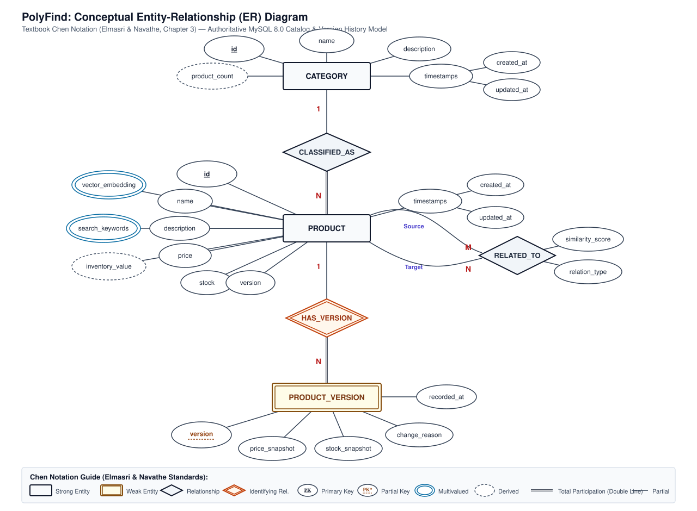
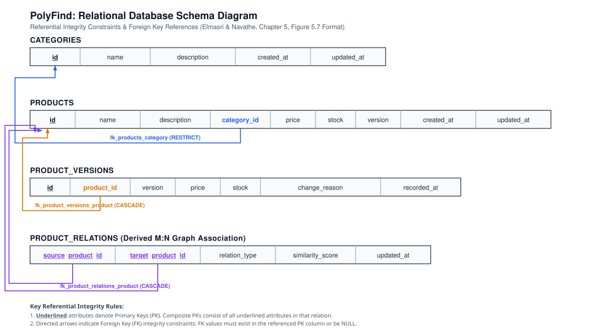

# PolyFind — Database Diagrams & Tables

---

## 1. Entity-Relationship (ER) Diagram

### 1.1. Visual Diagram (Chen's Extended Notation)
*(Based on Elmasri & Navathe, Chapter 3)*



---

### 1.2. Textual / Unicode Chen ER Diagram

```text
                                        ( name )
                                            │
        ( <u>id</u> ) ────────── [CATEGORY] ────────── ( description )
                     │            │       │
(--product_count--) ─┘            │       └─── (timestamps) ──┬── (created_at)
  [Derived]                       │                           └── (updated_at)
                                  │ 1 (Partial)
                                  │
                          ◇ CLASSIFIED_AS ◇
                                  ║
                                  ║ N (Total Participation: Every Product MUST have a Category)
                                  ▼
      ( <u>id</u> ) ───────────────┐
      ( name ) ─────────────┤
      ( description ) ──────┤
      ( price ) ────────────┤
      ( stock ) ────────────┼────── [PRODUCT]
      ( version ) ──────────┤         │
      ((vector_embedding)) ─┤         │ 1
        [Multivalued 384-d] │         │
      ((search_keywords)) ──┤         ▼
        [Multivalued Text]  │  ⟪ HAS_VERSION ⟫ [Identifying Relationship]
      (--inventory_value--) ┘         ║
        [Derived: price*stock]        ║ N (Total Participation: Cascade on Delete)
                                      ▼
                          ╔═════════════════════╗
                          ║   PRODUCT_VERSION   ║
                          ║    [Weak Entity]    ║
                          ╚═════════════════════╝
                                      │
         ┌────────────────────────────┼────────────────────────────┬────────────────────────────┐
         │                            │                            │                            │
 (··<u>version</u>··)              (price_snapshot)             (stock_snapshot)             (recorded_at)
  [Partial Key /
   Discriminator]
```

#### Notation Guide:
- **Rectangle:** Strong Entity (`CATEGORY`, `PRODUCT`)
- **Double Rectangle:** Weak Entity (`PRODUCT_VERSION`, existence dependent on `PRODUCT`)
- **Diamond:** Relationship (`CLASSIFIED_AS`)
- **Double Diamond:** Identifying Relationship (`HAS_VERSION`)
- **Oval with Solid Underline:** Primary Key (`id`)
- **Oval with Dashed Underline:** Partial Key / Discriminator (`version` in `PRODUCT_VERSION`)
- **Double Oval:** Multivalued Attribute (`vector_embedding`, `search_keywords`)
- **Dashed Oval:** Derived Attribute (`product_count`, `inventory_value`)
- **Double Line:** Total Participation / Existence Dependency

---

### 1.3. Interactive Mermaid Chen Flowchart

```mermaid
flowchart TD
    %% Entities
    CAT["CATEGORY"]:::strongEntity
    PROD["PRODUCT"]:::strongEntity
    PVER[["PRODUCT_VERSION"]]:::weakEntity

    %% Relationships
    R_CAT{"CLASSIFIED_AS"}:::relDiamond
    R_IDENT{{"HAS_VERSION"}}:::identRel

    %% Category Attributes
    CAT_ID(["<u>id</u>"]):::pkAttr
    CAT_NAME(["name"]):::atomAttr
    CAT_DESC(["description"]):::atomAttr
    CAT_COUNT(["- - product_count - -"]):::derivedAttr
    CAT_TIME(["timestamps"]):::compAttr
    CAT_CA(["created_at"]):::atomAttr
    CAT_UA(["updated_at"]):::atomAttr

    CAT_ID --- CAT
    CAT_NAME --- CAT
    CAT_DESC --- CAT
    CAT_COUNT -.- CAT
    CAT --- CAT_TIME
    CAT_TIME --- CAT_CA
    CAT_TIME --- CAT_UA

    %% Category to Product (1:N)
    CAT ---|1 (Partial)| R_CAT
    R_CAT ===|N (Total)| PROD

    %% Product Attributes
    P_ID(["<u>id</u>"]):::pkAttr
    P_NAME(["name"]):::atomAttr
    P_DESC(["description"]):::atomAttr
    P_PRICE(["price"]):::atomAttr
    P_STOCK(["stock"]):::atomAttr
    P_VER(["version"]):::atomAttr
    P_INV(["- - inventory_value - -"]):::derivedAttr
    P_VEC([("vector_embedding")]):::multiAttr
    P_KW([("search_keywords")]):::multiAttr

    P_ID --- PROD
    P_NAME --- PROD
    P_DESC --- PROD
    P_PRICE --- PROD
    P_STOCK --- PROD
    P_VER --- PROD
    P_INV -.- PROD
    P_VEC === PROD
    P_KW === PROD

    %% Product to Product Version (Identifying 1:N)
    PROD ---|1| R_IDENT
    R_IDENT ===|N (Total)| PVER

    %% Product Version Attributes
    PV_VER(["· · <u>version</u> · ·"]):::partialKeyAttr
    PV_PRICE(["price_snapshot"]):::atomAttr
    PV_STOCK(["stock_snapshot"]):::atomAttr
    PV_TIME(["recorded_at"]):::atomAttr

    PV_VER -.- PVER
    PV_PRICE --- PVER
    PV_STOCK --- PVER
    PV_TIME --- PVER

    classDef strongEntity fill:#f8fafc,stroke:#0f172a,stroke-width:2.5px,font-weight:bold;
    classDef weakEntity fill:#fefce8,stroke:#854d0e,stroke-width:3px,font-weight:bold;
    classDef relDiamond fill:#f1f5f9,stroke:#0f172a,stroke-width:2px,font-weight:bold;
    classDef identRel fill:#fff7ed,stroke:#c2410c,stroke-width:2.5px,font-weight:bold;
    classDef atomAttr fill:#ffffff,stroke:#334155,stroke-width:1.5px;
    classDef compAttr fill:#f8fafc,stroke:#334155,stroke-width:1.5px,stroke-dasharray: 2 1;
    classDef pkAttr fill:#ffffff,stroke:#0f172a,stroke-width:2.5px,font-weight:bold;
    classDef partialKeyAttr fill:#fefce8,stroke:#92400e,stroke-width:2px;
    classDef multiAttr fill:#ffffff,stroke:#0369a1,stroke-width:3px;
    classDef derivedAttr fill:#ffffff,stroke:#475569,stroke-width:1.5px,stroke-dasharray: 4 3;
```

---

## 2. Relational Schema

### 2.1. Visual Relational Schema Diagram (Foreign Key Arrows)
*(Based on Elmasri & Navathe, Chapter 5, Figure 5.7)*



---

### 2.2. Textual / Unicode Relational Box Diagram with Directed FK Arrows

```text
CATEGORIES
┌───────────┬──────────────┬──────────────────┬─────────────────┬─────────────────┐
│    <u>id</u>     │     name     │   description    │   created_at    │   updated_at    │
└─────▲─────┴──────────────┴──────────────────┴─────────────────┴─────────────────┘
      │
      │ ◄────────────────────────────────────────────────────────────────────────┐
      │                                                                          │  fk_products_category
      │                                                                          │  (ON UPDATE CASCADE
      │                                                                          │   ON DELETE RESTRICT)
PRODUCTS                                                                         │
┌─────┴─────┬──────────────┬──────────────────┬─────────────┬─────────┬──────────┴──┬─────────┬────────────┬────────────┐
│    <u>id</u>     │     name     │   description    │ category_id │  price  │    stock    │ version │ created_at │ updated_at │
└─────▲───▲─┴──────────────┴──────────────────┴──────┬──────┴─────────┴─────────────┴─────────┴────────────┴────────────┘
      │   │                                          │
      │   │                                          └───────────────────────────────────┘
      │   │
      │   │ ◄────────────────────────────────────────────────────────────────────┐
      │   │                                                                      │  fk_product_versions_product
      │   │                                                                      │  (ON UPDATE CASCADE
      │   │                                                                      │   ON DELETE CASCADE)
PRODUCT_VERSIONS                                                                 │
┌───────────┴──────────────┬──────────────────┬─────────────┬─────────┬──────────┴───────┬──────────────┐
│    <u>id</u>     │  product_id  │     version      │    price    │  stock  │   change_reason   │ recorded_at  │
└───────────┴───────┬──────┴──────────────────┴─────────────┴─────────┴──────────────────┴──────────────┘
                    │
                    └────────────────────────────────────────────────────────────────────┘
```

---

### 2.3. Schema Notation (Mathematical Format)

- **`CATEGORIES`** ( <u>`id`</u>, `name`, `description`, `created_at`, `updated_at` )
- **`PRODUCTS`** ( <u>`id`</u>, `name`, `description`, `category_id`, `price`, `stock`, `version`, `created_at`, `updated_at` )
  - **FK:** `category_id` references `CATEGORIES(id)`
- **`PRODUCT_VERSIONS`** ( <u>`id`</u>, `product_id`, `version`, `price`, `stock`, `change_reason`, `recorded_at` )
  - **FK:** `product_id` references `PRODUCTS(id)`
  - **Candidate Key:** `(product_id, version)`
- **`SCHEMA_MIGRATIONS`** ( <u>`id`</u>, `name`, `applied_at` )

---

## 3. All Tables (in DBMS) for the Project

### 3.1. Table: `categories`
Stores product taxonomy groups.

| Column Name | Data Type | Nullable | Key | Constraints / Default | Description |
|---|---|---|---|---|---|
| `id` | `VARCHAR(64)` | `NOT NULL` | **PK** | `CHECK(CHAR_LENGTH(TRIM(id)) > 0)` | Unique category identifier (e.g., `cat-electronics`, `cat-outdoors`) |
| `name` | `VARCHAR(255)` | `NOT NULL` | | `CHECK(CHAR_LENGTH(TRIM(name)) > 0)` | Display name of the category |
| `description` | `TEXT` | `NULL` | | | Detailed category description |
| `created_at` | `DATETIME(3)` | `NOT NULL` | | `DEFAULT CURRENT_TIMESTAMP(3)` | Initial creation timestamp |
| `updated_at` | `DATETIME(3)` | `NOT NULL` | | `DEFAULT CURRENT_TIMESTAMP(3) ON UPDATE CURRENT_TIMESTAMP(3)` | Last modification timestamp |

---

### 3.2. Table: `products`
Authoritative source of truth for all product facts (price, stock, version).

| Column Name | Data Type | Nullable | Key | Constraints / Default | Description |
|---|---|---|---|---|---|
| `id` | `VARCHAR(64)` | `NOT NULL` | **PK** | `CHECK(CHAR_LENGTH(TRIM(id)) > 0)` | Unique product SKU / identifier (e.g., `prod-0001`) |
| `name` | `VARCHAR(255)` | `NOT NULL` | | `CHECK(CHAR_LENGTH(TRIM(name)) > 0)` | Product title |
| `description` | `TEXT` | `NOT NULL` | | | Full product description |
| `category_id` | `VARCHAR(64)` | `NOT NULL` | **FK** | `REFERENCES categories(id) ON UPDATE CASCADE ON DELETE RESTRICT` | Category classification |
| `price` | `DECIMAL(10,2)` | `NOT NULL` | | `CHECK(price >= 0.00)` | Authoritative sales price |
| `stock` | `INT` | `NOT NULL` | | `CHECK(stock >= 0)` | Available physical inventory count |
| `version` | `BIGINT UNSIGNED` | `NOT NULL` | | `DEFAULT 1, CHECK(version > 0)` | Monotonic version counter for cache freshness verification |
| `created_at` | `DATETIME(3)` | `NOT NULL` | | `DEFAULT CURRENT_TIMESTAMP(3)` | Initial creation timestamp |
| `updated_at` | `DATETIME(3)` | `NOT NULL` | | `DEFAULT CURRENT_TIMESTAMP(3) ON UPDATE CURRENT_TIMESTAMP(3)` | Last mutation timestamp |

#### Indexes on `products`:
1. `PRIMARY KEY (id)` — Clustered B-Tree index.
2. `idx_products_category_price (category_id, price)` — Composite B-Tree index for filtered range queries.
3. `idx_products_stock (stock)` — B-Tree index for in-stock filtering.
4. `idx_products_updated_at (updated_at)` — B-Tree index for CDC synchronization queries.
5. `idx_products_search (name, description)` — MySQL `FULLTEXT` Inverted Index for keyword search.

---

### 3.3. Table: `product_versions`
Audit ledger tracking historical price and inventory changes for each product.

| Column Name | Data Type | Nullable | Key | Constraints / Default | Description |
|---|---|---|---|---|---|
| `id` | `BIGINT UNSIGNED` | `NOT NULL` | **PK** | `AUTO_INCREMENT` | Surrogate log entry sequence number |
| `product_id` | `VARCHAR(64)` | `NOT NULL` | **FK** | `REFERENCES products(id) ON UPDATE CASCADE ON DELETE CASCADE` | Associated product identifier |
| `version` | `BIGINT UNSIGNED` | `NOT NULL` | | `CHECK(version > 0)` | Monotonic version number at the time of change |
| `price` | `DECIMAL(10,2)` | `NOT NULL` | | `CHECK(price >= 0.00)` | Historical price at this version snapshot |
| `stock` | `INT` | `NOT NULL` | | `CHECK(stock >= 0)` | Historical inventory at this version snapshot |
| `change_reason` | `VARCHAR(255)` | `NULL` | | | Reason for update (e.g. `flash_sale`, `restock`, `initial_import`) |
| `recorded_at` | `DATETIME(3)` | `NOT NULL` | | `DEFAULT CURRENT_TIMESTAMP(3)` | Snapshot timestamp |

#### Unique Constraint on `product_versions`:
- `UNIQUE KEY uq_product_version (product_id, version)` — Guarantees strict version numbering sequence per product.

---

### 3.4. Table: `schema_migrations`
Internal migration tracking ledger for database schema evolution.

| Column Name | Data Type | Nullable | Key | Constraints / Default | Description |
|---|---|---|---|---|---|
| `id` | `INT` | `NOT NULL` | **PK** | `AUTO_INCREMENT` | Migration sequence number |
| `name` | `VARCHAR(255)` | `NOT NULL` | **UK** | `UNIQUE` | Migration filename (e.g., `001_initial_schema.sql`, `002_catalog_indexes.sql`) |
| `applied_at` | `DATETIME(3)` | `NOT NULL` | | `DEFAULT CURRENT_TIMESTAMP(3)` | Timestamp when migration was executed |

---

### Complete SQL DDL (Ready for Execution in MySQL Workbench)

```sql
-- Migration 001: Initial Schema
CREATE TABLE IF NOT EXISTS categories (
  id VARCHAR(64) NOT NULL,
  name VARCHAR(255) NOT NULL,
  description TEXT NULL,
  created_at DATETIME(3) NOT NULL DEFAULT CURRENT_TIMESTAMP(3),
  updated_at DATETIME(3) NOT NULL DEFAULT CURRENT_TIMESTAMP(3) ON UPDATE CURRENT_TIMESTAMP(3),
  CONSTRAINT pk_categories PRIMARY KEY (id),
  CONSTRAINT chk_category_id_non_empty CHECK (CHAR_LENGTH(TRIM(id)) > 0),
  CONSTRAINT chk_category_name_non_empty CHECK (CHAR_LENGTH(TRIM(name)) > 0)
) ENGINE=InnoDB DEFAULT CHARSET=utf8mb4 COLLATE=utf8mb4_unicode_ci;

CREATE TABLE IF NOT EXISTS products (
  id VARCHAR(64) NOT NULL,
  name VARCHAR(255) NOT NULL,
  description TEXT NOT NULL,
  category_id VARCHAR(64) NOT NULL,
  price DECIMAL(10, 2) NOT NULL,
  stock INT NOT NULL,
  version BIGINT UNSIGNED NOT NULL DEFAULT 1,
  created_at DATETIME(3) NOT NULL DEFAULT CURRENT_TIMESTAMP(3),
  updated_at DATETIME(3) NOT NULL DEFAULT CURRENT_TIMESTAMP(3) ON UPDATE CURRENT_TIMESTAMP(3),
  CONSTRAINT pk_products PRIMARY KEY (id),
  CONSTRAINT fk_products_category FOREIGN KEY (category_id) REFERENCES categories(id) ON UPDATE CASCADE ON DELETE RESTRICT,
  CONSTRAINT chk_product_id_non_empty CHECK (CHAR_LENGTH(TRIM(id)) > 0),
  CONSTRAINT chk_product_name_non_empty CHECK (CHAR_LENGTH(TRIM(name)) > 0),
  CONSTRAINT chk_product_price_non_negative CHECK (price >= 0),
  CONSTRAINT chk_product_stock_non_negative CHECK (stock >= 0),
  CONSTRAINT chk_product_version_positive CHECK (version > 0)
) ENGINE=InnoDB DEFAULT CHARSET=utf8mb4 COLLATE=utf8mb4_unicode_ci;

CREATE TABLE IF NOT EXISTS product_versions (
  id BIGINT UNSIGNED AUTO_INCREMENT NOT NULL,
  product_id VARCHAR(64) NOT NULL,
  version BIGINT UNSIGNED NOT NULL,
  price DECIMAL(10, 2) NOT NULL,
  stock INT NOT NULL,
  change_reason VARCHAR(255) NULL,
  recorded_at DATETIME(3) NOT NULL DEFAULT CURRENT_TIMESTAMP(3),
  CONSTRAINT pk_product_versions PRIMARY KEY (id),
  CONSTRAINT fk_product_versions_product FOREIGN KEY (product_id) REFERENCES products(id) ON UPDATE CASCADE ON DELETE CASCADE,
  CONSTRAINT uq_product_version UNIQUE (product_id, version),
  CONSTRAINT chk_product_version_price_non_negative CHECK (price >= 0),
  CONSTRAINT chk_product_version_stock_non_negative CHECK (stock >= 0),
  CONSTRAINT chk_product_version_num_positive CHECK (version > 0)
) ENGINE=InnoDB DEFAULT CHARSET=utf8mb4 COLLATE=utf8mb4_unicode_ci;

-- Migration 002: Indexes
CREATE INDEX idx_products_category_price ON products (category_id, price);
CREATE INDEX idx_products_stock ON products (stock);
CREATE INDEX idx_products_updated_at ON products (updated_at);
CREATE FULLTEXT INDEX idx_products_search ON products (name, description);
```
