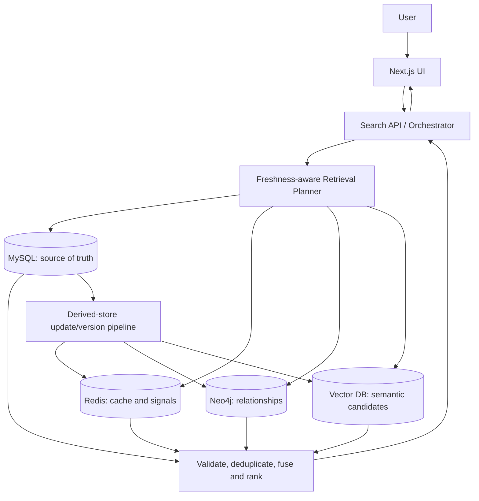

# Architecture — PolyFind

## Stack
- Frontend/application: Next.js, TypeScript
- Authoritative relational database: MySQL
- Cache/query signals: Redis
- Relationship retrieval: Neo4j
- Semantic retrieval: one vector database, selected in S1
- Embeddings: provider/model selected and recorded in S1
- Tests: unit and integration tests plus a reproducible benchmark harness
- Hosting: local development first; deployment is not in initial scope

## System flow

## Modules
- `catalog` — authoritative product/catalog CRUD and SQL constraints.
- `search-api` — request validation, response contract, pagination, error handling.
- `retrieval-planner` — selects retrieval paths based on query class, freshness requirement, and observed costs.
- `cache` — Redis keys, TTLs, version metadata, invalidation and bypass rules.
- `graph-retrieval` — graph schema, relationship queries, candidate generation.
- `semantic-retrieval` — embedding generation, vector adapter, candidate generation.
- `sync` — propagates changes from MySQL to derived stores; tracks versions and retry/failure state.
- `fusion` — candidate normalization, deduplication, filtering, ranking and explanation signals.
- `benchmark` — deterministic workloads, baselines, metrics, experiment configuration and result export.
- `web-ui` — search controls, results, filters, freshness/diagnostic view for development.
- `auth` — only if authentication is approved for v1.

## Data authority and freshness
- MySQL is the source of truth for transactional fields such as price and stock.
- Redis, Neo4j, and the vector index are derived/retrieval-supporting representations, not authoritative sources for those fields.
- Each derived record should carry an entity identifier and version/update timestamp where supported.
- Freshness rules must be explicit by field class; a single TTL is not treated as a universal consistency guarantee.
- If a freshness-sensitive value cannot be verified, the system must either read the authoritative source or return a clearly defined unavailable/degraded response. It must not silently present an unverified stale value as current.
- The synchronization mechanism must make retries and failures observable.

## API contract (initial proposal)
| Method | Path | Request | Response |
|---|---|---|---|
| GET | `/api/health` | — | `{ status }` |
| GET | `/api/products` | `q?, category?, minPrice?, maxPrice?, page?, limit?` | `{ items, page, total }` |
| GET | `/api/products/:id` | — | `{ item }` |
| POST | `/api/products` | product fields (development/admin only) | `{ item }` |
| PATCH | `/api/products/:id` | changed fields + expected version | `{ item, version }` |
| POST | `/api/search` | `{ query, filters, freshnessMode?, limit? }` | `{ items, strategy, timings, freshness }` |
| POST | `/api/benchmark/run` | workload/config identifier (development only) | `{ runId, status }` |
| GET | `/api/benchmark/results/:runId` | — | `{ config, metrics, artifacts }` |

API paths and shapes are proposed contracts; align implementation and tests before external use. Benchmark endpoints must not be exposed in a public deployment.

## Data model (initial)
- `Product` — authoritative product fields; many-to-one `Category`.
- `Category` — product classification.
- `ProductVersion` or version columns — monotonic version/update metadata for freshness validation.
- `SearchQueryEvent` — optional aggregate query signal; avoid storing unnecessary personal data.
- Neo4j nodes/edges — derived product/category/related-entity relationships keyed by stable MySQL IDs.
- Vector records — embedding plus stable product ID and source version.
- Redis entries — cache key, result payload/IDs, creation/expiry metadata and relevant version marker.

## Constraints
- Expected scale: a reproducible capstone-scale dataset; benchmark sizes to be documented rather than assumed.
- Performance: report median and p95 latency; do not promise a numeric target until baseline measurements exist.
- Security: validate input, use parameterized SQL, least-privilege credentials, no committed secrets, and safe error messages.
- Correctness: transactional facts come from MySQL; stale derived values must not override them.
- Reproducibility: pin versions, seed generated data/workloads, and record benchmark configuration.
- Scope: one vector store, local-first, no payment features or production integrations.

## Module ownership

- **Member A:** MySQL catalog/schema/transactions; relational correctness; retrieval contracts and baseline fusion; version metadata; freshness validation; planner baselines; deterministic workload/relevance metrics; failure/regression/security checks; statistical summaries; research claims; final acceptance.
- **Member B:** Local development configuration; vector-store/embedding evaluation; seed fixture/validation; catalog UI; embedding ingestion; vector adapter; Neo4j graph/synchronization; Redis cache/invalidation; search API/UI integration; benchmark harness/ablation experiments; result visualization; report/demo.
- **No module or slice is jointly owned.** Cross-module interfaces are agreed early; each owner develops against fixtures or mocks while other components are in progress. See `docs/PARALLEL_WORK_PLAN.md`.
