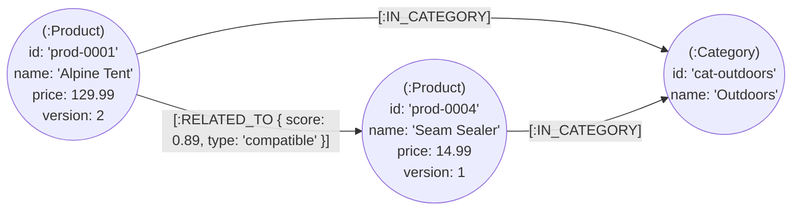
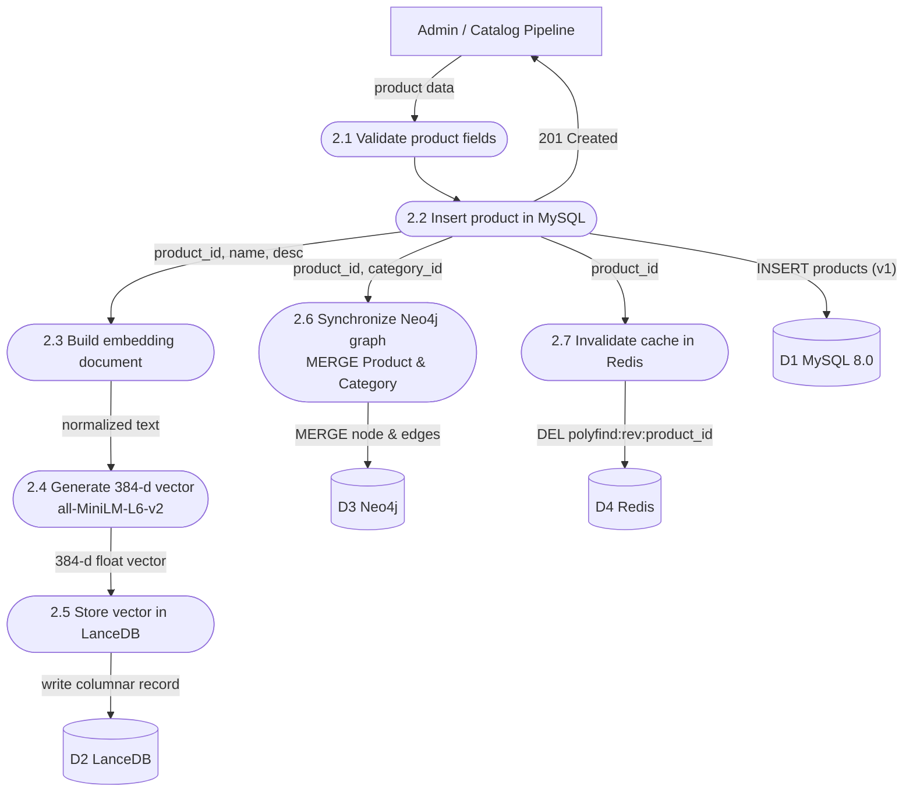
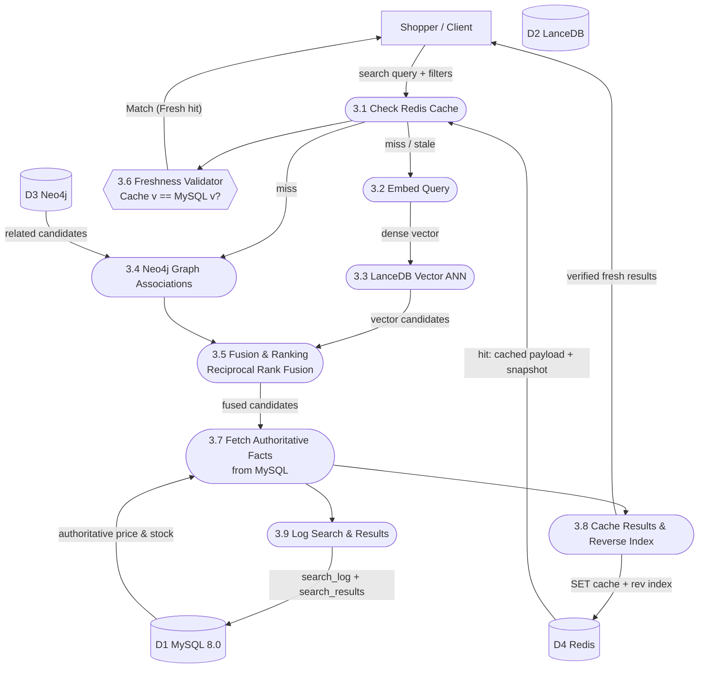
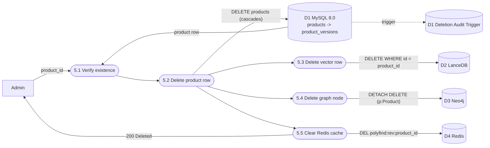
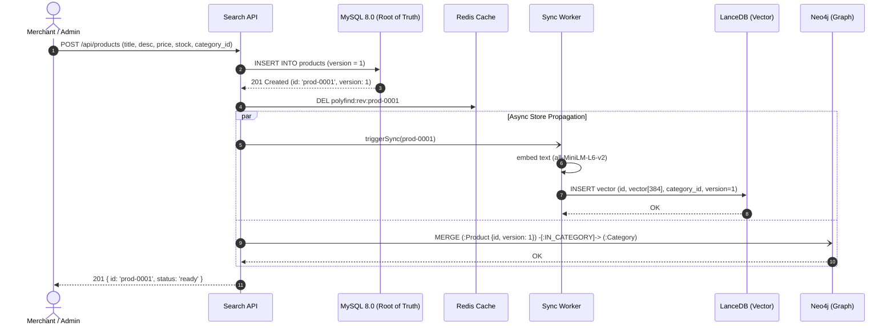
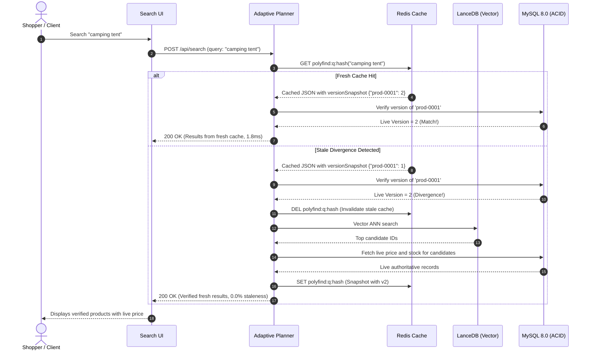

# PolyFind — Non-Relational Stores (Vector, Graph, Key-Value)

> Companion document: [relation-schema.md](relation-schema.md) covers the authoritative MySQL schema, relational constraints, cascades, trigger, view, and Level 0 / Level 1 data flow diagrams.

---

## 1. Why more than one database

PolyFind uses **polyglot persistence**: each kind of data goes to the database engine designed specifically for its workload. **MySQL 8.0 is the sole root of truth** for commercial catalog facts, inventory transactions, and monotonic versions. The three non-relational stores below each fulfill one specialized retrieval role.

| Store | Engine | Job in PolyFind | Hosting / Execution |
|---|---|---|---|
| **Vector** | **LanceDB** (or InMemory) | Retrieve candidate products whose semantic *meaning* matches a natural language query | Local Embedded Columnar / Arrow |
| **Graph** | **Neo4j 5.x** | Multi-hop category hierarchy & related product graph recommendations | Neo4j Local / Aura |
| **Key-value** | **Redis 7.0** | Sub-2ms response caching with version snapshot binding & targeted invalidation | Redis Local / Upstash |

### How the stores are linked

All stores share stable product and category identifiers generated authoritatively by MySQL. No derived store is allowed to invent its own entities or override transactional facts.

| ID / Attribute | MySQL 8.0 (Source of Truth) | LanceDB (Vector) | Neo4j (Graph) | Redis (Key-Value) |
|---|---|---|---|---|
| `product_id` (`id`) | `products.id`, `product_versions.product_id` | `id` (Columnar PK) | `Product.id` | In cached payload & `polyfind:rev:{id}` |
| `category_id` | `categories.id`, `products.category_id` | `category_id` (Filter metadata) | `Category.id` | Inside cached query response |
| `version` | `products.version`, `product_versions.version` | `version` (Sync guard) | `Product.version` | In version snapshot: `{ prod_id: version }` |
| `price` & `stock` | Authoritative (`products.price`, `products.stock`) | Informational copy | Informational copy | In cached response (verified on hit) |

Every read requiring strict freshness verifies that the derived entity's version matches live MySQL before presenting transactional facts to users (see ADR-001 & ADR-002).

---

## 2. Vector store — LanceDB

### Schema & Columnar Layout
LanceDB stores dense vector representations in Apache Arrow columnar format:

```text
Table: product_embeddings
├── id:          Utf8 / VARCHAR(64)       -- Same value as MySQL products.id (Primary Key)
├── vector:      FixedSizeList(Float32, 384) -- 384-dimensional unit-normalized embedding
├── category_id: Utf8                     -- Copied here for push-down metadata pre-filtering
├── price:       Float32                  -- Copied here for range predicate pushdown
├── stock:       Int32                    -- Filter for in-stock products (stock > 0)
├── version:     Int64                    -- Monotonic version snapshot guard
└── doc_text:    Utf8                     -- Preprocessed concatenated title + description
```

| Concept | Value |
|---|---|
| Embedding model | `sentence-transformers/all-MiniLM-L6-v2` |
| Vector dimensions | 384 dimensions ($L_2$ unit-normalized: $\sum v_i^2 = 1.0$) |
| Distance metric | **Cosine distance** ($1.0 - \text{cosine\_similarity}$). $0.0$ means identical meaning. |
| Preprocessing pipeline | Product title + Category name + Description $\rightarrow$ lowercase $\rightarrow$ punctuation cleanup $\rightarrow$ whitespace collapsed |
| Confidence threshold | If best similarity score is **$< 0.40$**, the retrieval planner automatically falls back to MySQL `FULLTEXT` search. |

### Vector Similarity & Predicate Query
```typescript
// Query LanceDB with vector similarity and metadata push-down filters
const queryVector = await embeddingProvider.generateEmbedding("compact lightweight camping tent");

const results = await lancedbTable
  .search(queryVector)
  .metricType("cosine")
  .where("category_id = 'cat-outdoors' AND stock > 0")
  .limit(10)
  .execute();
```

---

## 3. Graph store — Neo4j

### Graph model



| Node Label | Properties | Identified by |
|---|---|---|
| `:Product` | `id`, `name`, `price`, `stock`, `version` | `id` (Unique Constraint) |
| `:Category` | `id`, `name`, `slug` | `id` (Unique Constraint) |

| Relationship Type | Meaning | Attributes |
|---|---|---|
| `(:Product)-[:IN_CATEGORY]->(:Category)` | Product taxonomy assignment | — |
| `(:Product)-[:RELATED_TO]->(:Product)` | Frequently bought together, compatible, or accessory | `score` (Float $0.0 \dots 1.0$), `type` (String) |

### Cypher queries

**1. Write / Update Product with Monotonic Version Guard**  
Uses `MERGE` so out-of-order CDC updates can never overwrite a newer version:
```cypher
MERGE (p:Product { id: $id })
ON CREATE SET p.name = $name,
              p.price = $price,
              p.stock = $stock,
              p.version = $version
ON MATCH SET p.name = CASE WHEN $version > p.version THEN $name ELSE p.name END,
             p.price = CASE WHEN $version > p.version THEN $price ELSE p.price END,
             p.stock = CASE WHEN $version > p.version THEN $stock ELSE p.stock END,
             p.version = CASE WHEN $version > p.version THEN $version ELSE p.version END;
```

**2. Link Product to Category**
```cypher
MATCH (p:Product { id: $product_id })
MATCH (c:Category { id: $category_id })
MERGE (p)-[:IN_CATEGORY]->(c);
```

**3. Recommend Related Products (Multi-Hop Graph Traversal)**
```cypher
MATCH (p1:Product { id: $product_id })-[r:RELATED_TO]->(p2:Product)
WHERE p2.stock > 0
RETURN p2.id AS product_id, p2.name AS name, p2.price AS price, r.score AS similarity, r.type AS relation_type
ORDER BY r.score DESC
LIMIT 5;
```

**4. Delete Product Node & Dangling Edges**
```cypher
MATCH (p:Product { id: $product_id })
DETACH DELETE p;
```

---

## 4. Key-value cache — Redis

| Aspect | Value |
|---|---|
| **Forward Query Key** | `polyfind:q:{sha256(normalized_query_and_filters)}` |
| **Key Normalization** | Lowercase, trim query text, alphabetize filter keys (e.g. `category=cat-outdoors&q=tent`) |
| **Value Payload** | JSON SearchResponse including candidates, ranks, scores, and **Version Snapshot**: `{ "prod-0001": 2, "prod-0004": 1 }` |
| **Expiry (TTL)** | 60 seconds (Short default TTL prevents long-term stale drift) |
| **Reverse Invalidation Index** | Set at key `polyfind:rev:{product_id}` containing all query cache keys referencing that product |
| **Targeted Invalidation** | When MySQL mutates `prod-0001`, Redis reads `polyfind:rev:prod-0001` and executes `DEL` only on affected queries |

### Example Cache Entries:

**1. Forward Query Cache:**
```
KEY:   polyfind:q:e3b0c44298fc1c149afbf4c8996fb92427ae41e4649b934ca495991b7852b855
TTL:   60
VALUE: {
  "query": "camping tent",
  "items": [
    { "id": "prod-0001", "name": "Alpine Tent", "price": 129.99, "version": 2 },
    { "id": "prod-0004", "name": "Seam Sealer", "price": 14.99, "version": 1 }
  ],
  "versionSnapshot": {
    "prod-0001": 2,
    "prod-0004": 1
  }
}
```

**2. Reverse Product Invalidation Set:**
```
KEY:     polyfind:rev:prod-0001
MEMBERS: [
  "polyfind:q:e3b0c44298fc1c149afbf4c8996fb92427ae41e4649b934ca495991b7852b855",
  "polyfind:q:7a3f89b1c2d3e4f5a6b7c8d9e0f1a2b3c4d5e6f7a8b9c0d1e2f3a4b5c6d7e8f9"
]
```

### Stale-Read Rejection Mechanism
Even in the event of an unpurged cache hit, the **Freshness Validator** inspects the cached `versionSnapshot` against MySQL's live versions. If `cached_version < live_version`, the cache hit is instantly rejected, purged, and re-fetched from authoritative MySQL.

---

## 5. Summary — what each operation touches

| Operation | MySQL 8.0 | LanceDB (Vector) | Neo4j (Graph) | Redis 7.0 (Cache) |
|---|---|---|---|---|
| **Add Product** | Write (`INSERT`) | Write (Embed & insert vector) | Write (`MERGE` node + category edge) | Clear related category queries |
| **Flash-Sale Price Update** | Write (`version = version + 1`) + Audit row | Update version | Update price & version | **Targeted Invalidation** (`polyfind:rev:id`) |
| **Text / Vector Search** | Log query & results | Read (Cosine ANN candidates) | — | Read / Write forward cache |
| **Category Browsing** | Read (B-Tree index) | — | Read (Traverse category tree) | Read / Write cache |
| **Related Recommendations** | Verify stock & price | — | Read (`[:RELATED_TO]` edges) | Read / Write cache |
| **Delete Product** | Delete (`CASCADE` + Audit trigger) | Delete vector row | Delete node (`DETACH DELETE`) | Clear affected query keys |
| **Freshness Check** | Read authoritative version | Compare snapshot | Compare snapshot | Reject stale entry if version < MySQL |

---

## 6. Data flow diagrams

**Notation:** rectangle = external entity · rounded box = process · cylinder = data store · arrow = data flow.

### Level 2 — 2.0 Ingest & Embed (Multi-Store Synchronization)



---

### Level 2 — 3.0 Adaptive Freshness-Constrained Search



---

### Level 2 — 5.0 Delete Product



---

## 7. Sequence diagrams

### Sequence 1 — Ingestion & Multi-Store Synchronization



---

### Sequence 2 — Adaptive Search (Freshness Verification & Stale Invalidation)


