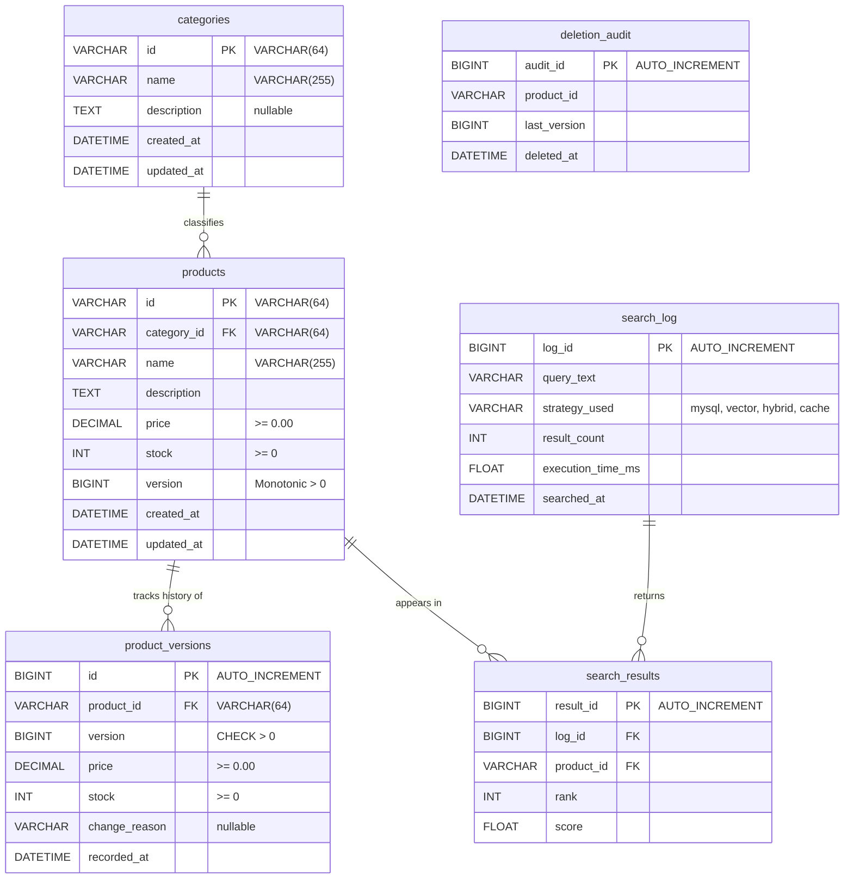
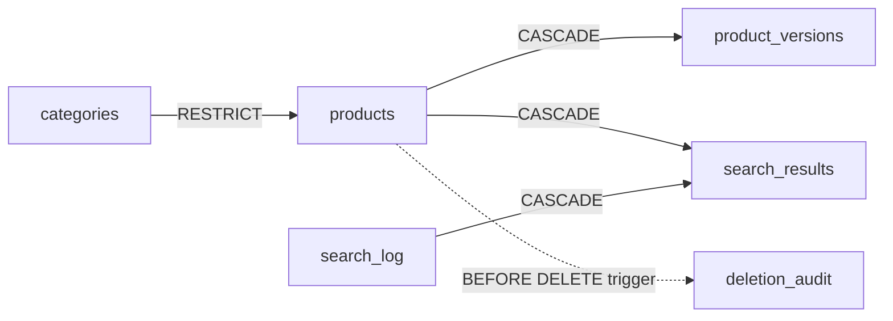
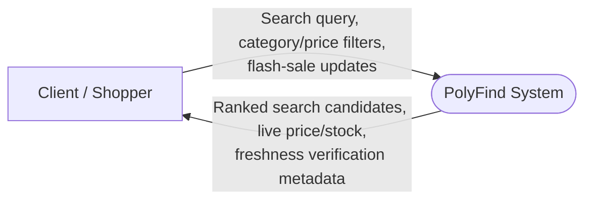
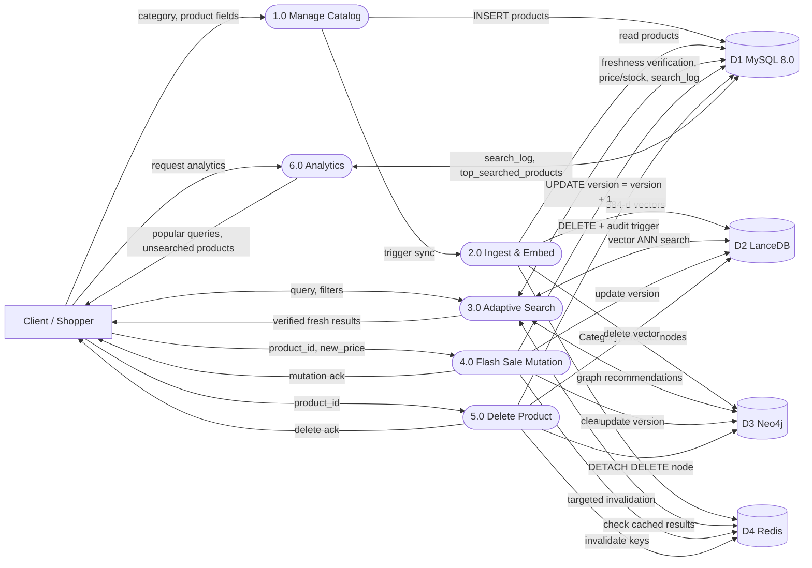
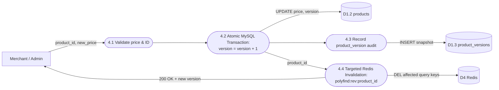
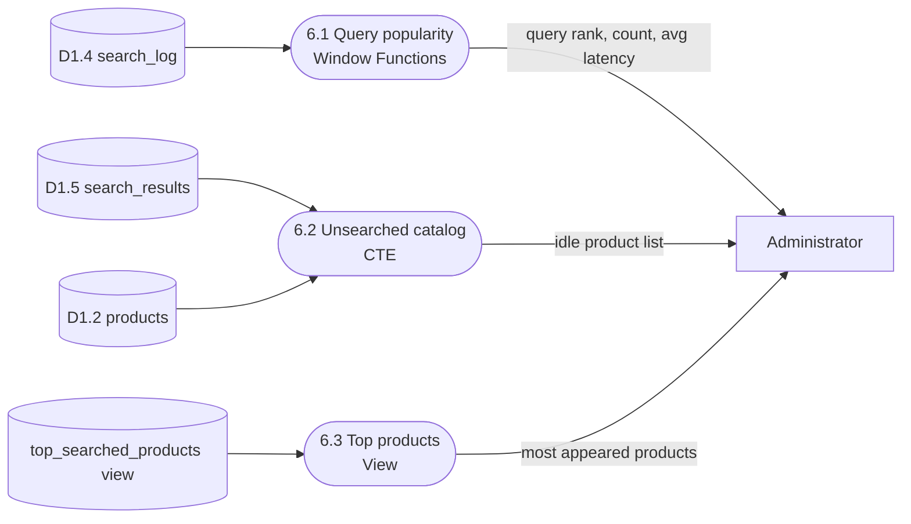

# PolyFind — Relational Schema (MySQL)

> Companion document: [nosql-schema.md](nosql-schema.md) covers LanceDB (Vector), Neo4j (Graph), and Redis (Key-Value Cache).

---

## 1. Where MySQL fits

PolyFind stores each kind of data in the database best suited to it. **MySQL 8.0 is the authoritative source of truth**: it owns categories, products, transactional facts (price and stock), version metadata, and search audit history. Every non-relational derived store refers back to stable IDs generated by MySQL.

| Store | Engine | What it holds | Document |
|---|---|---|---|
| **Relational** | **MySQL 8.0 (InnoDB)** | **Categories, products, version audit history, search log, audit** | **this file** |
| Vector | LanceDB / Columnar | One 384-dimensional dense embedding per product (`all-MiniLM-L6-v2`) | [nosql-schema.md](nosql-schema.md#2-vector-store--lancedb) |
| Graph | Neo4j 5.x | Product → Category taxonomy and Product → Product recommendation links | [nosql-schema.md](nosql-schema.md#3-graph-store--neo4j) |
| Key-value | Redis 7.0 | Cached search query responses & reverse invalidation index | [nosql-schema.md](nosql-schema.md#4-key-value-cache--redis) |

All SQL queries use parameterized queries (no heavy ORM) with InnoDB transactional guarantees. The schema is created by numbered SQL scripts in `migrations/`, applied in order:
- `migrations/001_initial_schema.sql` (Tables and domain constraints)
- `migrations/002_catalog_indexes.sql` (B-Tree and FULLTEXT indexes)

---

## 2. Entity–Relationship diagram



**Reading the diagram**

- A **category** classifies zero, one, or many **products**.
- Each **product** must belong to exactly one **category** (`category_id` NOT NULL).
- A **product** has many historical **product_versions** capturing price and stock adjustments over time.
- **search_log** records each query evaluated by the system, tracking strategy, execution time, and result count.
- Each search records up to 10 ranked **search_results**, linking the query to the retrieved **product**.
- **deletion_audit** deliberately has no foreign key constraint: it preserves an audit trail of products that have been deleted from the catalog.

---

## 3. Tables

### `categories`
Commercial taxonomy groups for products.

| Column | Type | Notes |
|---|---|---|
| `id` | VARCHAR(64) | **Primary key** (e.g., `cat-outdoors`, `cat-electronics`). Non-empty check. |
| `name` | VARCHAR(255) | Required display name. Non-empty check. |
| `description` | TEXT, nullable | Explanatory description of the category. |
| `created_at` | DATETIME(3) | Defaults to `CURRENT_TIMESTAMP(3)` |
| `updated_at` | DATETIME(3) | Defaults to `CURRENT_TIMESTAMP(3) ON UPDATE CURRENT_TIMESTAMP(3)` |

### `products`
Authoritative transactional record for all catalog inventory.

| Column | Type | Notes |
|---|---|---|
| `id` | VARCHAR(64) | **Primary key** (e.g., `prod-0001`). Non-empty check. |
| `category_id` | VARCHAR(64) | **FK → `categories`**, `ON UPDATE CASCADE ON DELETE RESTRICT` |
| `name` | VARCHAR(255) | Product title. Non-empty check. |
| `description` | TEXT | Detailed item overview. **FULLTEXT indexed**. |
| `price` | DECIMAL(10,2) | Authoritative selling price. `CHECK(price >= 0.00)` |
| `stock` | INT | Authoritative physical inventory count. `CHECK(stock >= 0)` |
| `version` | BIGINT UNSIGNED | Monotonic integer sequence. Defaults to 1. Incremented on every update. |
| `created_at` | DATETIME(3) | Defaults to `CURRENT_TIMESTAMP(3)` |
| `updated_at` | DATETIME(3) | Defaults to `CURRENT_TIMESTAMP(3) ON UPDATE CURRENT_TIMESTAMP(3)` |

### `product_versions`
Audit ledger tracking historical price/stock mutations for consistency verification and rollback.

| Column | Type | Notes |
|---|---|---|
| `id` | BIGINT UNSIGNED, auto-increment | **Primary key** |
| `product_id` | VARCHAR(64) | **FK → `products`**, `ON UPDATE CASCADE ON DELETE CASCADE` |
| `version` | BIGINT UNSIGNED | Monotonic version number snapshot. `CHECK(version > 0)` |
| `price` | DECIMAL(10,2) | Historical price at this version. `CHECK(price >= 0.00)` |
| `stock` | INT | Historical stock at this version. `CHECK(stock >= 0)` |
| `change_reason` | VARCHAR(255), nullable | Reason for change (e.g., `flash_sale`, `restock`, `price_drop`) |
| `recorded_at` | DATETIME(3) | Defaults to `CURRENT_TIMESTAMP(3)` |

> **Unique Constraint:** `uq_product_version (product_id, version)` ensures each product has a strict, collision-free version sequence.

### `search_log`
Records queries processed by the adaptive planner.

| Column | Type | Notes |
|---|---|---|
| `log_id` | BIGINT UNSIGNED, auto-increment | **Primary key** |
| `query_text` | VARCHAR(255) | Trimmed search query string |
| `strategy_used` | VARCHAR(50) | Retrieval plan chosen: `cache_hit`, `mysql_exact`, `vector_ann`, `hybrid_rrf` |
| `result_count` | INT | Number of returned candidates |
| `execution_time_ms` | FLOAT | Total end-to-end retrieval latency in milliseconds |
| `searched_at` | DATETIME(3) | Timestamp of the search execution |

### `search_results`
The ranked product candidates returned for each search.

| Column | Type | Notes |
|---|---|---|
| `result_id` | BIGINT UNSIGNED, auto-increment | **Primary key** |
| `log_id` | BIGINT UNSIGNED | **FK → `search_log`**, `ON DELETE CASCADE` |
| `product_id` | VARCHAR(64) | **FK → `products`**, `ON DELETE CASCADE` |
| `rank` | INT | Position in results (1, 2, 3 …) |
| `score` | FLOAT | Normalized ranking or Reciprocal Rank Fusion (RRF) score |

### `deletion_audit`
Audit trail written by a trigger whenever a product is deleted from the catalog.

| Column | Type | Notes |
|---|---|---|
| `audit_id` | BIGINT UNSIGNED, auto-increment | **Primary key** |
| `product_id` | VARCHAR(64) | ID of the deleted product (no FK, row is purged) |
| `last_version` | BIGINT UNSIGNED | Last active version number before deletion |
| `deleted_at` | DATETIME(3) | When the deletion occurred |

### `schema_migrations` (bookkeeping)
Tracks applied migration scripts so migrations run once and idempotently. Primary key is `id` with `UNIQUE(name)`.

---

## 4. Constraints, cascades, view, trigger, indexes

### Cascade chain
Deleting a category or product cleans up dependent child records safely:



### Trigger — `before_product_delete`
Automatically records deleted products into the audit log before the row is purged:
```sql
DELIMITER $$
CREATE TRIGGER before_product_delete
BEFORE DELETE ON products
FOR EACH ROW
BEGIN
    INSERT INTO deletion_audit (product_id, last_version, deleted_at)
    VALUES (OLD.id, OLD.version, NOW(3));
END$$
DELIMITER ;
```

### View — `top_searched_products`
Aggregates catalog performance and ranks products by how frequently they appear in search results:
```sql
CREATE OR REPLACE VIEW top_searched_products AS
SELECT p.id AS product_id,
       p.name AS product_name,
       p.category_id,
       p.price,
       p.stock,
       COUNT(sr.result_id) AS appearance_count,
       AVG(sr.score)        AS avg_rank_score
FROM search_results sr
JOIN products p ON sr.product_id = p.id
GROUP BY p.id, p.name, p.category_id, p.price, p.stock;
```

### Indexes
| Index | Table & Columns | Why |
|---|---|---|
| Primary Keys | `categories(id)`, `products(id)`, `product_versions(id)` | Identity, entity integrity, clustered B+Tree lookups |
| `uq_product_version` | `product_versions(product_id, version)` | Prevents duplicate version sequence collisions |
| `idx_products_category_price` | `products(category_id, price)` | Composite B-Tree index for filtered range queries (`category = ? AND price BETWEEN ? AND ?`) |
| `idx_products_stock` | `products(stock)` | Fast filtering for available stock (`stock > 0`) |
| `idx_products_updated_at` | `products(updated_at)` | Fast incremental Change Data Capture (CDC) sync queries |
| `idx_products_search` (FULLTEXT) | `products(name, description)` | Keyword-search fallback (`MATCH … AGAINST IN BOOLEAN MODE`) |

---

## 5. Normalization

| Normal form | How the PolyFind schema meets it |
|---|---|
| **1NF** | Every column holds an atomic, indivisible value. No repeating groups. Multivalued vector embeddings and graph relationships are decoupled into LanceDB and Neo4j rather than stored as serialized JSON strings. |
| **2NF** | All non-key attributes are fully functionally dependent on the entire primary key. In `product_versions`, `(product_id, version)` uniquely identifies price and stock snapshots without partial dependencies. |
| **3NF** | No transitive dependencies. In `products`, non-key attributes (`name`, `price`, `stock`, `version`) depend directly on `id`. Category details (`name`, `description`) are stored separately in `categories` and linked via foreign key `category_id`. Aggregates like `appearance_count` are computed via the `top_searched_products` view instead of stored redundantly. |
| **BCNF** | Every determinant is a candidate key. In `categories`, `id` is a candidate key. In `product_versions`, both surrogate `id` and natural key `(product_id, version)` are candidate keys. |

---

## 6. Key queries

These are the primary SQL statements executed by the PolyFind backend. Every query uses parameterized placeholders to prevent SQL injection.

**1. Product lookup with version metadata**
```sql
SELECT id, name, description, category_id, price, stock, version, updated_at
FROM products
WHERE id = ?;
```

**2. Category-filtered price range search** (uses composite B-Tree index `idx_products_category_price`)
```sql
SELECT id, name, category_id, price, stock, version
FROM products
WHERE category_id = ?
  AND price BETWEEN ? AND ?
  AND stock > 0
ORDER BY price ASC
LIMIT ? OFFSET ?;
```

**3. Keyword fallback search** (uses inverted index `idx_products_search`)
```sql
SELECT id, name, description, category_id, price, stock, version,
       MATCH(name, description) AGAINST(? IN BOOLEAN MODE) AS relevance_score
FROM products
WHERE MATCH(name, description) AGAINST(? IN BOOLEAN MODE)
ORDER BY relevance_score DESC
LIMIT ?;
```

**4. Transactional Flash-Sale Price Mutation with Version Increment** (Atomic ACID transaction)
```sql
START TRANSACTION;

-- Increment version and update price
UPDATE products
SET price = ?, version = version + 1
WHERE id = ?;

-- Record audit version snapshot
INSERT INTO product_versions (product_id, version, price, stock, change_reason, recorded_at)
SELECT id, version, price, stock, ?, NOW(3)
FROM products
WHERE id = ?;

COMMIT;
```

**5. Popular search queries analytics** (Window functions)
```sql
SELECT query_text,
       COUNT(*)                             AS search_count,
       RANK() OVER (ORDER BY COUNT(*) DESC) AS query_rank,
       MAX(searched_at)                     AS last_searched,
       AVG(execution_time_ms)               AS avg_latency_ms
FROM search_log
GROUP BY query_text
ORDER BY query_rank
LIMIT 10;
```

**6. Unsearched products with zero activity** (Common Table Expression / CTE)
```sql
WITH active_searched_products AS (
    SELECT DISTINCT product_id
    FROM search_results
)
SELECT p.id, p.name, p.category_id, p.price, p.stock
FROM products p
WHERE p.id NOT IN (SELECT product_id FROM active_searched_products)
ORDER BY p.created_at DESC;
```

**7. Top searched products view query**
```sql
SELECT product_id, product_name, category_id, price, stock, appearance_count, avg_rank_score
FROM top_searched_products
ORDER BY appearance_count DESC
LIMIT 10;
```

---

## 7. Data flow diagrams

**Notation:** rectangle = external entity · rounded box = process · cylinder = data store · arrow = data flow.

### Level 0 — Context diagram



### Level 1 — System processes



### Level 2 — 1.0 Manage Catalog & 4.0 Flash Sale Mutation



### Level 2 — 6.0 Analytics (Read-Only)


